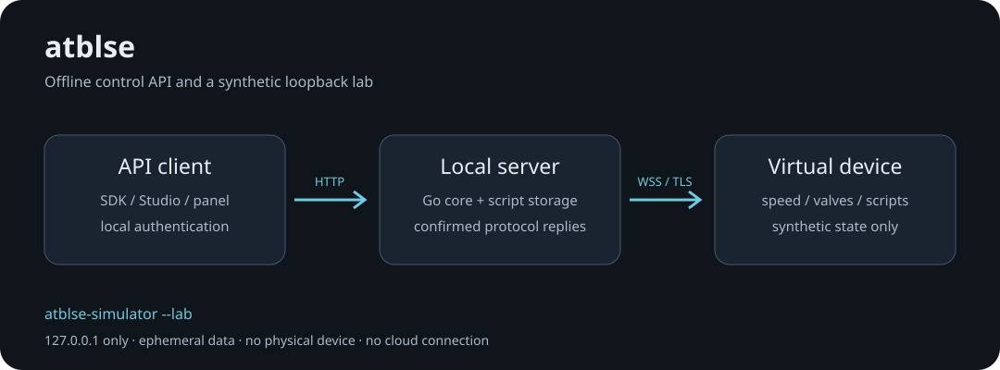

# ATBL-SE

**Autoblow Server Emulator**

[Русский](README.ru.md)



Run a stock VacuGlide 2 through a local server, with a diagnostic panel and an API for clients such as VacuGlide Studio.

- The built server starts and operates without internet access or a cloud account.
- Portable Go core, optional Windows hotspot wrapper, and a NAS Docker configuration with automatic restart disabled.
- Manual speed and valves, 30 local slots, Funscript/CSV conversion, script transfer, seeking, looping and events.
- A standalone virtual device and an isolated loopback lab for development without hardware.

**Candidate 0.2.0-rc.2.** The firmware profile is VacuGlide 2 `1.03`/`1.0.3`. Software tests are separate from physical acceptance. This candidate still needs real-device, Windows Hotspot and network/power-loss acceptance. AI Ultra, cloud accounts, video services and firmware updates are outside this product.

## Try the local lab

With Go 1.24 or later (verification uses Go 1.27.3):

```sh
go build -o out/vacuglide-simulator ./cmd/vacuglide-simulator
./out/vacuglide-simulator --lab --duration 10m
```

On Windows, build with `-o out/vacuglide-simulator.exe` and run that file. The command prints a temporary panel URL, local control key and synthetic MAC. Open the URL, enter the key, and pair the displayed virtual device. Nothing is sent to the official service. The lab removes its temporary state when it exits normally.

Development dependencies must be obtained before an offline build. The compiled application does not download them at startup. The current panel and Windows shell use Russian labels.

## Use the server

Build `./cmd/autoblow-server`, prepare a private configuration from `deploy/server.example.json`, and follow the [installation and API guide](docs/en/guide.md). Keep the API private. The default maximum speed is 15%; script playback and external-client control need explicit configuration.

The diagnostic panel uses a renewable session. External API clients own their STOP behavior. Disconnecting the server cannot prove a motor has physically stopped, and the server never resumes a previous run automatically.

- [Windows, NAS and router/DNS setup](docs/en/guide.md#installation-and-network)
- [API, protocol and valve semantics](docs/en/guide.md#api-and-protocol)
- [Simulator, offline codec and research tools](docs/en/guide.md#developer-tools)
- [Project passport and acceptance](docs/en/project.md)
- [Contributing](CONTRIBUTING.md), [security reporting](SECURITY.md), [repository standard](docs/en/development-standard.md)
- [Releases](https://github.com/nd4y/atbl-se/releases) and [issues](https://github.com/nd4y/atbl-se/issues)

No project-wide open-source license has been selected; see [LICENSE.md](LICENSE.md) and [third-party notices](THIRD_PARTY_NOTICES.md). No firmware images, video-library collection, account/session captures or production credentials are distributed here.
